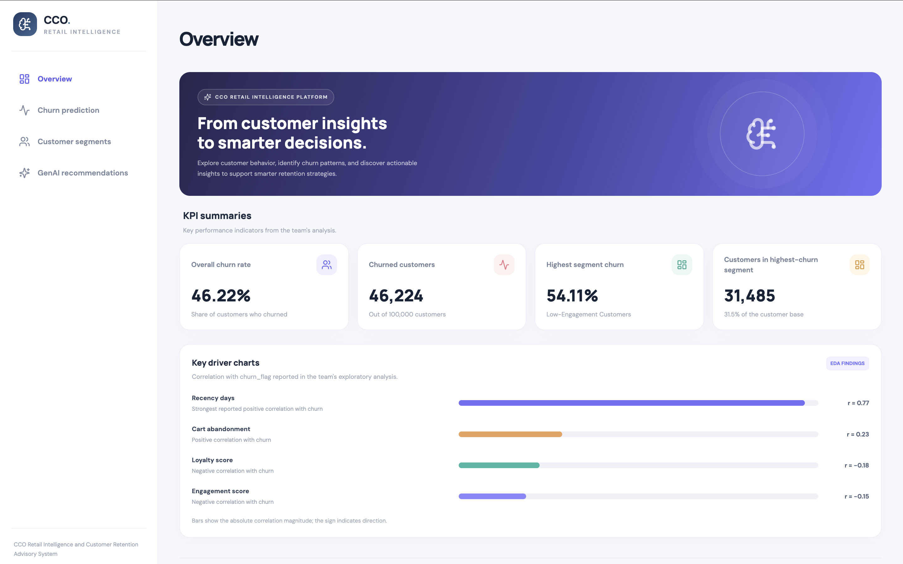
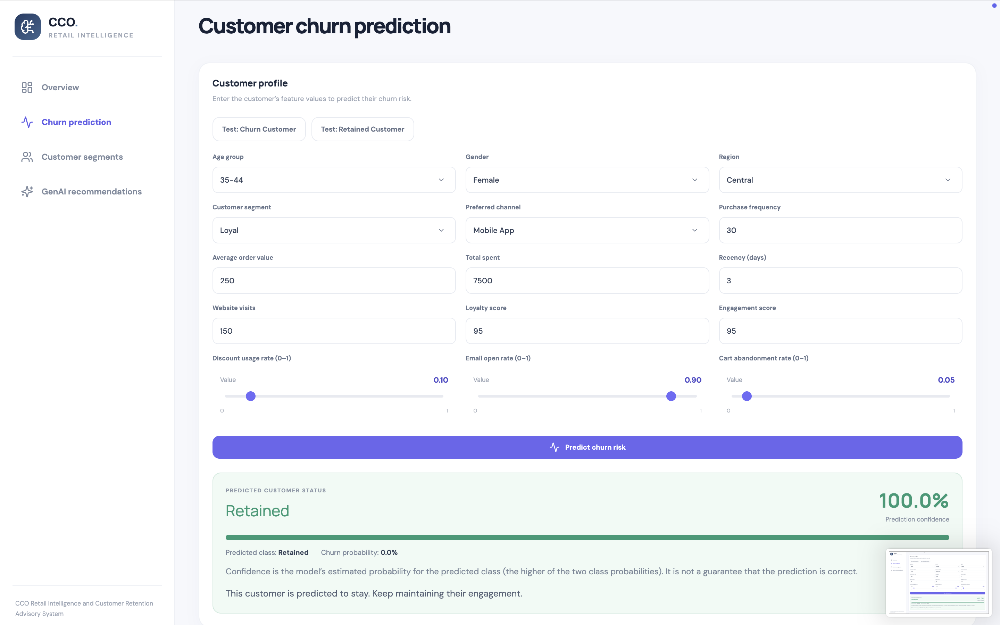
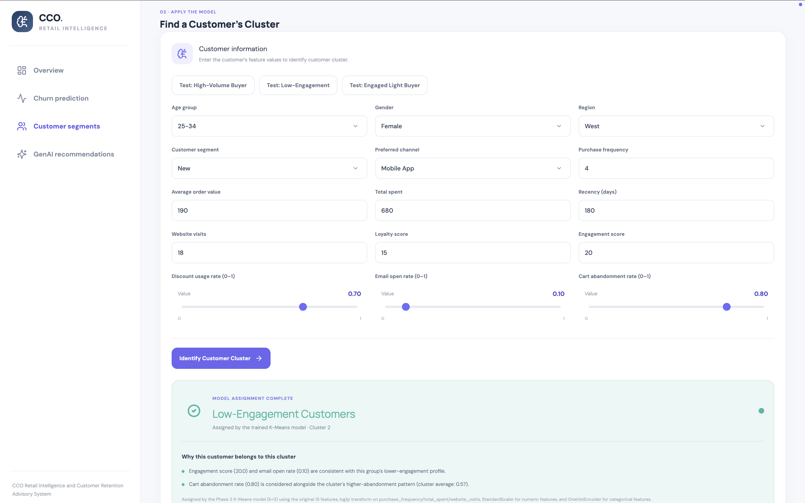
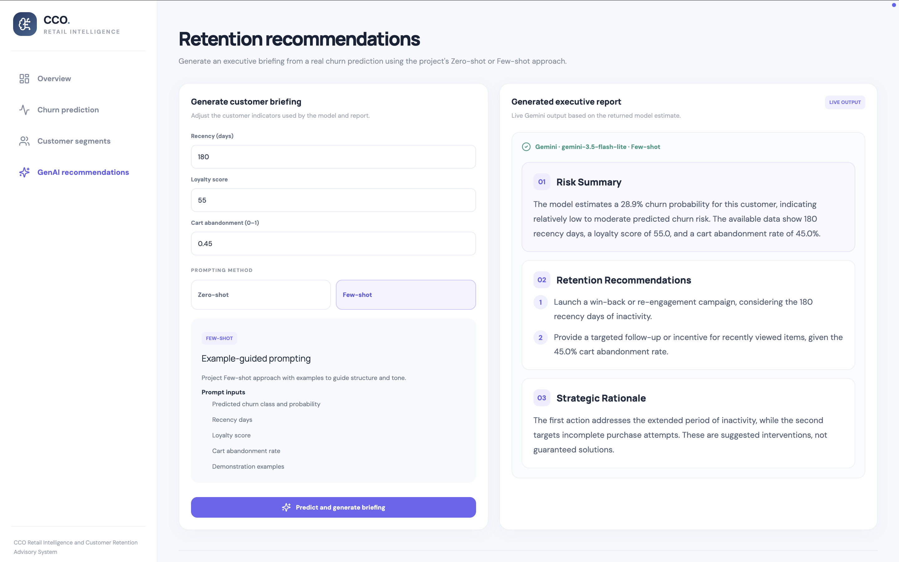
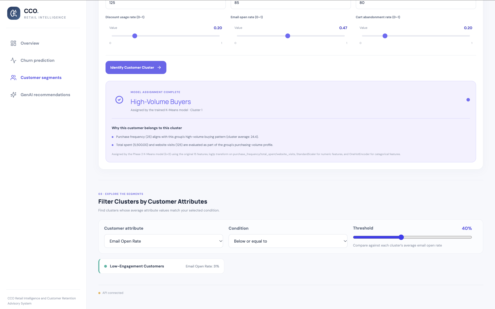
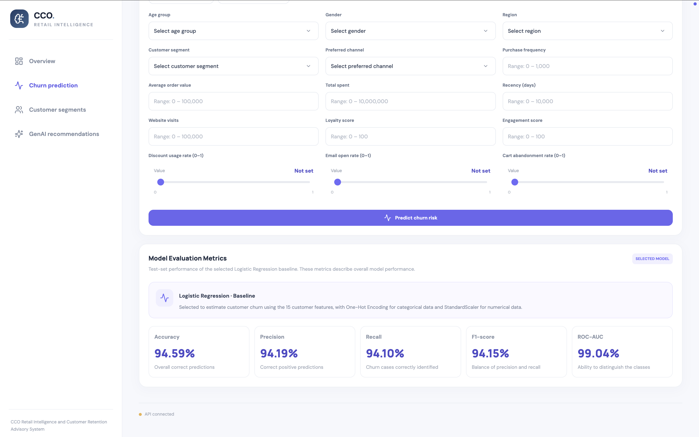

# CCO Retail Intelligence and Customer Retention Advisory System

**SWE485: Selected Topics in Software Engineering**
Software Engineering Department, King Saud University
1st Semester 1448

**Group #:** [6]

## Group Members

| # | Name | ID |
|---|------|----|
| 1 | Danah Alsayari | 445201210 |
| 2 | Raghad Alabrah | 445202369 |
| 3 | Lulwah Alqadi | 445201197 |
| 4 | Latifah Almarshad | 445200273 |
| 5 | Joory Alharbi | 445203081 |
| 6 | Madawi Aldayel | 445201395 |

## Project Title

CCO Retail Intelligence and Customer Retention Advisory System (Chief Customer Officer)

## Motivation

Customer churn is one of the most critical challenges in retail and e-commerce. Retaining an existing customer is generally cheaper than acquiring a new one, so even a small improvement in retention can significantly impact revenue and long-term growth. Executives need to know early which high-value customers are at risk of defecting so they can act before it is too late.

This project builds an advisory system for a Chief Customer Officer (CCO) that:

- predicts high-value retail customer defection (churn) from shopping behavior and engagement signals,
- uncovers behavioral customer personas through unsupervised clustering.
- equips executive teams with GenAI-driven retention intervention strategies through an interactive dashboard.

We selected the **Retail Intelligence: Customer Churn Dataset** (Kaggle, 100,000 customer records, 18 columns) because it combines customer demographics, purchasing behavior, engagement signals, and loyalty indicators with a binary churn label (`churn_flag`), which makes it well suited to classification, customer segmentation, and decision support.


## General Information

### Group Work

The project work is distributed among the six team members as follows. Each member is responsible for completing the assigned tasks, documenting the work, and communicating progress to the team.

| Team Member| Responsibilities |
|---|---|
| **Danah Alsayari** | Define the problem and domain, select and describe the dataset, explain the project motivation, and document the dataset |
| **Joory Alharbi** | Perform initial data inspection, conduct Exploratory Data Analysis (EDA), create visualizations, and summarize key insights. |
| **Lulwah Alqadi** | Develop the preprocessing pipeline, document preprocessing steps and justifications, and prepare the dataset for modeling. |
| **Madawi Aldayel** | Select the two supervised learning models, compare their performance, analyze the results, justify the best model, and document next steps for Phase 2. |
| **Raghad Alabrah** | Implement and train Model 1, tune hyperparameters, and evaluate its performance using metrics and visualizations. |
| **Latifah Almarshad** | Implement and train Model 2, tune hyperparameters, and evaluate its performance using metrics and visualizations. |


### AI Tools Usage and Acknowledgment

AI-assisted tools were used as supplementary resources during the project to support the team's learning, documentation, and problem-solving process.

The tools were used for the following purposes, where applicable:

- **Documentation and Writing:** Improving the clarity, grammar, and organization of project documentation.
- **Code Debugging:** Assisting with investigating errors.

## Executive Decision-Making Interface & Dashboard

The project includes an interactive executive dashboard that integrates customer churn predictions, customer segmentation, and GenAI-supported retention insights to support customer retention decisions.

- **Live Dashboard:** [https://ui-p2iak52wy-danah7.vercel.app/](https://ui-p2iak52wy-danah7.vercel.app/)
- **UI Repository:** [https://github.com/DanahAlsayari/ui](https://github.com/DanahAlsayari/ui)

### Dashboard Features

- **Overview Dashboard:** Presents executive KPI summaries, including the overall churn rate, number of churned customers, the customer segment with the highest churn rate, and key driver charts.
  
  

- **Churn Prediction:** Uses the Phase 1 baseline Logistic Regression model to predict customer churn and display the churn probability and prediction confidence.

  

- **Customer Segmentation:** Uses the Phase 2 K-Means model to identify customer segments, visualize their profiles, and present recommended retention actions.

  

- **GenAI Retention Insights:** Generates a risk summary, actionable retention recommendations, and a strategic rationale based on prediction results and selected customer attributes.

  

### Visual Analytics Integration

The dashboard incorporates interactive visual analytics components to help users explore customer behavior, interpret model predictions, and understand key business performance indicators.

- **Scenario Sliders:** Allow users to adjust customer input values and explore how different inputs affect the prediction results.
  
  

- **Confidence Metrics:** Display the prediction confidence alongside the churn probability to help users interpret the model's output.

  

- **KPI Summaries:** Present key business indicators, including the overall churn rate, number of churned customers, and highest-risk customer segment.

  

### Setup and Execution

The project provides two options for accessing and running the dashboard:

**Option 1: Access the Live Dashboard**

You can access the deployed application directly through this link ([https://ui-p2iak52wy-danah7.vercel.app/](https://ui-p2iak52wy-danah7.vercel.app/)) without downloading or installing the project locally.

**Option 2: Download and Run Locally**

You can download or clone the project repository and run the application in your local development environment. The repository includes the project source code and backend requirements needed for local setup.

For local execution, you need to configure the required environment variables and install the frontend and backend dependencies before starting the respective services. Additional setup instructions are provided below.

#### Local Setup Instructions

1. Clone the repository:
   ```bash
   git clone https://github.com/DanahAlsayari/ui.git
   cd ui
   ```

2. **Start the Backend:**
   ```bash
   cd backend
   pip install -r requirements.txt
   uvicorn main:app --reload
   ```

3. **Start the Frontend:** Open a new terminal in the project root and run:
   ```bash
   npm install
   npm run dev
   ```

4. **Add the .env File:** Place the `.env` file we sent you inside the `backend` folder in the cloned repository.